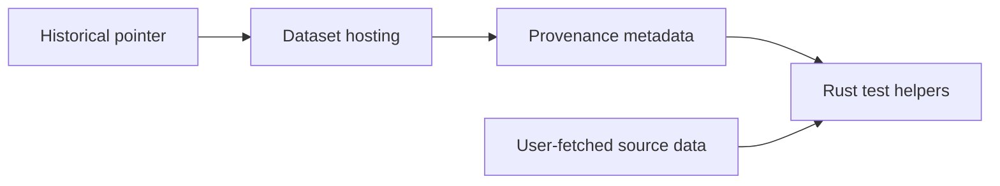
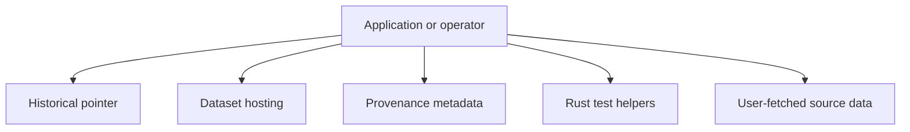
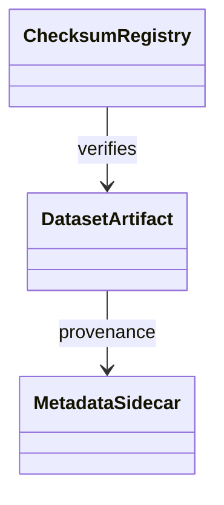
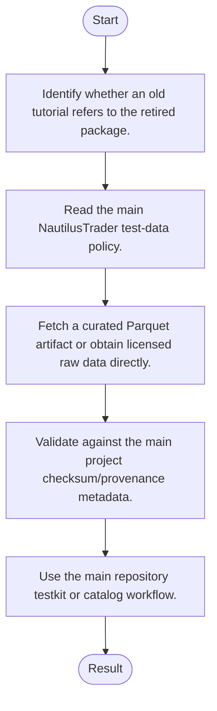
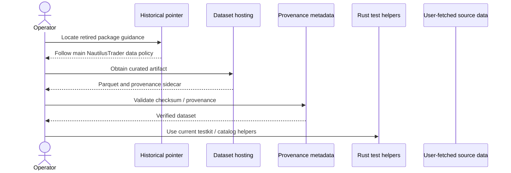
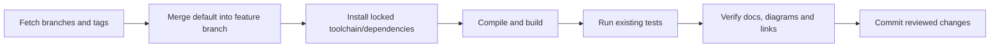

# nautilus_data: architecture, features and workflows

Updated: 2026-10-12 · Branch: `feature/ayu_develop` · Source snapshot: `daa84ef`

[Development and layout](development.md) · [Validation evidence](validation.md) · [HTML edition](ayu-develop.html)

## Purpose and scope

This upstream repository was decommissioned in May 2026. It is now a historical pointer to NautilusTrader test datasets, provenance sidecars, checksums and public R2 hosting. The retired nautilus_data Python package and container workflow are intentionally absent; this maintenance branch preserves that upstream decision.

## Features

- Preserves old repository links without retaining an unmaintained package.
- Points to EURUSD.SIM quote and instrument Parquet datasets.
- Directs checksum/provenance maintenance to the main NautilusTrader repository.
- Distinguishes publicly hosted curated data from user-fetched raw HISTDATA.
- Provides a migration route for old package/container consumers.

## Components and responsibilities

| Component | Responsibility | Implementation |
| --- | --- | --- |
| Historical pointer | Explains retirement and the replacement data workflow | [README.md](../README.md) |
| Dataset hosting | Documents the public quote/instrument Parquet locations | [README.md](../README.md) |
| Provenance metadata | Lists sidecars and the checksum registry in the main project | [README.md](../README.md) |
| Rust test helpers | Documents the replacement Nautilus testkit helper functions | [README.md](../README.md) |
| User-fetched source data | Describes the raw HISTDATA download policy | [README.md](../README.md) |

## Architecture and boundaries

The following view shows the principal responsibilities and their data-flow relationship. It is a conceptual architecture view; each implementation link above identifies the owning source. Native or external services retain their own lifecycle and configuration.



### Component ownership

The boundaries below distinguish entry points from their state/model and integration responsibilities. Data validation, numerical semantics and external protocol handling belong in the owning modules rather than in documentation or deployment scripts.



## Types and relationships

The following schema is conceptual: this repository uses modules/reactive stores, shared service contracts or dataset metadata rather than implementing these as a class hierarchy. Source ownership is given in the component table.



## Runtime workflow

1. Identify whether an old tutorial refers to the retired package.
2. Read the main NautilusTrader test-data policy.
3. Fetch a curated Parquet artifact or obtain licensed raw data directly.
4. Validate against the main project checksum/provenance metadata.
5. Use the main repository testkit or catalog workflow.



## Sequence of a typical operation

This sequence expands the responsibility flow described above. The named participants correspond to the component table; error handling and any service-specific prerequisites remain part of the implementation.



## Development and verification workflow

Sync the upstream refs, merge the actual default branch into `feature/ayu_develop`, resolve conflicts, install the documented environment and run the existing build/test commands. Keep lockfiles and source changes together so another checkout can reproduce the environment.



### Commands

```sh
git log -1 --oneline
git status --short
```

The exact commands executed, interpreter/compiler versions, pass/fail counts and any prerequisites are recorded in [validation.md](validation.md). A syntax-only pass is reported separately from a package/native build and from runtime tests.

## Source navigation

These links refer to files in this checkout. They remain useful when the repository is opened locally; the source snapshot above identifies the revision used for this guide.

- [README.md](../README.md)

This repository contains fewer than ten implementation files. The guide deliberately links the available source rather than inventing code paths.
