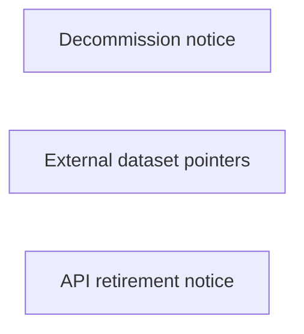

# nautilus_data: workflow, design and architecture

Updated: **2026-10-13**
Reviewed Git hash: `30ffd0ff456a5be8e3d1d3f97ac5b9f33aa0ca47`
Branch: `feature/ayu_develop`
Source diff SHA256: `e3b0c44298fc1c149afbf4c8996fb92427ae41e4649b934ca495991b7852b855`
Scope: **Retired reference** / Maintenance: **retired**
Languages: Markdown

[HTML edition](ayu-develop.html) / [Development](development.md) / [Historical validation](validation.md) / [Full system comparison](../../docs/index.html)

## Purpose and scope

Decommissioned historical pointer to NautilusTrader test-data policy and hosted EURUSD.SIM Parquet artifacts.

## Features and support boundaries

Native = implemented here. Integration = supplied through a named host/API. Limited = material restriction. Not provided = evidenced scope exclusion. Unverified = support/absence not established. Not applicable = outside this artifact type.

| Capability | Status | Implementation and limits | Source |
|---|---|---|---|
| Backtesting | Not applicable | No maintained executable trading/research runtime is established by this reference checkout. | [README.md](../README.md) ([L5](https://github.com/alexcwyu/nautilus_data/blob/30ffd0ff456a5be8e3d1d3f97ac5b9f33aa0ca47/README.md#L5)) |
| Live execution | Not applicable | No maintained executable trading/research runtime is established by this reference checkout. | [README.md](../README.md) ([L5](https://github.com/alexcwyu/nautilus_data/blob/30ffd0ff456a5be8e3d1d3f97ac5b9f33aa0ca47/README.md#L5)) |
| Paper trading | Not applicable | No maintained executable trading/research runtime is established by this reference checkout. | [README.md](../README.md) ([L5](https://github.com/alexcwyu/nautilus_data/blob/30ffd0ff456a5be8e3d1d3f97ac5b9f33aa0ca47/README.md#L5)) |
| Event driven | Not applicable | No maintained executable trading/research runtime is established by this reference checkout. | [README.md](../README.md) ([L5](https://github.com/alexcwyu/nautilus_data/blob/30ffd0ff456a5be8e3d1d3f97ac5b9f33aa0ca47/README.md#L5)) |
| Vectorized | Not applicable | No maintained executable trading/research runtime is established by this reference checkout. | [README.md](../README.md) ([L5](https://github.com/alexcwyu/nautilus_data/blob/30ffd0ff456a5be8e3d1d3f97ac5b9f33aa0ca47/README.md#L5)) |
| Order management | Not applicable | No maintained executable trading/research runtime is established by this reference checkout. | [README.md](../README.md) ([L5](https://github.com/alexcwyu/nautilus_data/blob/30ffd0ff456a5be8e3d1d3f97ac5b9f33aa0ca47/README.md#L5)) |
| Order types | Not applicable | No maintained executable trading/research runtime is established by this reference checkout. | [README.md](../README.md) ([L5](https://github.com/alexcwyu/nautilus_data/blob/30ffd0ff456a5be8e3d1d3f97ac5b9f33aa0ca47/README.md#L5)) |
| Multi venue | Not applicable | No maintained executable trading/research runtime is established by this reference checkout. | [README.md](../README.md) ([L5](https://github.com/alexcwyu/nautilus_data/blob/30ffd0ff456a5be8e3d1d3f97ac5b9f33aa0ca47/README.md#L5)) |
| Crypto | Not applicable | No maintained executable trading/research runtime is established by this reference checkout. | [README.md](../README.md) ([L5](https://github.com/alexcwyu/nautilus_data/blob/30ffd0ff456a5be8e3d1d3f97ac5b9f33aa0ca47/README.md#L5)) |
| Equities | Not applicable | No maintained executable trading/research runtime is established by this reference checkout. | [README.md](../README.md) ([L5](https://github.com/alexcwyu/nautilus_data/blob/30ffd0ff456a5be8e3d1d3f97ac5b9f33aa0ca47/README.md#L5)) |
| Futures | Not applicable | No maintained executable trading/research runtime is established by this reference checkout. | [README.md](../README.md) ([L5](https://github.com/alexcwyu/nautilus_data/blob/30ffd0ff456a5be8e3d1d3f97ac5b9f33aa0ca47/README.md#L5)) |
| Options | Not applicable | No maintained executable trading/research runtime is established by this reference checkout. | [README.md](../README.md) ([L5](https://github.com/alexcwyu/nautilus_data/blob/30ffd0ff456a5be8e3d1d3f97ac5b9f33aa0ca47/README.md#L5)) |
| Forex | Not applicable | No maintained executable trading/research runtime is established by this reference checkout. | [README.md](../README.md) ([L5](https://github.com/alexcwyu/nautilus_data/blob/30ffd0ff456a5be8e3d1d3f97ac5b9f33aa0ca47/README.md#L5)) |
| Strategy api | Not applicable | No maintained executable trading/research runtime is established by this reference checkout. | [README.md](../README.md) ([L5](https://github.com/alexcwyu/nautilus_data/blob/30ffd0ff456a5be8e3d1d3f97ac5b9f33aa0ca47/README.md#L5)) |
| Optimization | Not applicable | No maintained executable trading/research runtime is established by this reference checkout. | [README.md](../README.md) ([L5](https://github.com/alexcwyu/nautilus_data/blob/30ffd0ff456a5be8e3d1d3f97ac5b9f33aa0ca47/README.md#L5)) |
| Machine learning | Not applicable | No maintained executable trading/research runtime is established by this reference checkout. | [README.md](../README.md) ([L5](https://github.com/alexcwyu/nautilus_data/blob/30ffd0ff456a5be8e3d1d3f97ac5b9f33aa0ca47/README.md#L5)) |
| Reinforcement learning | Not applicable | No maintained executable trading/research runtime is established by this reference checkout. | [README.md](../README.md) ([L5](https://github.com/alexcwyu/nautilus_data/blob/30ffd0ff456a5be8e3d1d3f97ac5b9f33aa0ca47/README.md#L5)) |
| Portfolio | Not applicable | No maintained executable trading/research runtime is established by this reference checkout. | [README.md](../README.md) ([L5](https://github.com/alexcwyu/nautilus_data/blob/30ffd0ff456a5be8e3d1d3f97ac5b9f33aa0ca47/README.md#L5)) |
| Risk management | Not applicable | No maintained executable trading/research runtime is established by this reference checkout. | [README.md](../README.md) ([L5](https://github.com/alexcwyu/nautilus_data/blob/30ffd0ff456a5be8e3d1d3f97ac5b9f33aa0ca47/README.md#L5)) |
| Performance analytics | Not applicable | No maintained executable trading/research runtime is established by this reference checkout. | [README.md](../README.md) ([L5](https://github.com/alexcwyu/nautilus_data/blob/30ffd0ff456a5be8e3d1d3f97ac5b9f33aa0ca47/README.md#L5)) |
| Historical data | Not applicable | No maintained executable trading/research runtime is established by this reference checkout. | [README.md](../README.md) ([L5](https://github.com/alexcwyu/nautilus_data/blob/30ffd0ff456a5be8e3d1d3f97ac5b9f33aa0ca47/README.md#L5)) |
| Streaming data | Not applicable | No maintained executable trading/research runtime is established by this reference checkout. | [README.md](../README.md) ([L5](https://github.com/alexcwyu/nautilus_data/blob/30ffd0ff456a5be8e3d1d3f97ac5b9f33aa0ca47/README.md#L5)) |
| Persistence | Not applicable | No maintained executable trading/research runtime is established by this reference checkout. | [README.md](../README.md) ([L5](https://github.com/alexcwyu/nautilus_data/blob/30ffd0ff456a5be8e3d1d3f97ac5b9f33aa0ca47/README.md#L5)) |
| Data pipeline | Not applicable | No maintained executable trading/research runtime is established by this reference checkout. | [README.md](../README.md) ([L5](https://github.com/alexcwyu/nautilus_data/blob/30ffd0ff456a5be8e3d1d3f97ac5b9f33aa0ca47/README.md#L5)) |
| Web ui | Not applicable | No maintained executable trading/research runtime is established by this reference checkout. | [README.md](../README.md) ([L5](https://github.com/alexcwyu/nautilus_data/blob/30ffd0ff456a5be8e3d1d3f97ac5b9f33aa0ca47/README.md#L5)) |
| Cli | Not applicable | No maintained executable trading/research runtime is established by this reference checkout. | [README.md](../README.md) ([L5](https://github.com/alexcwyu/nautilus_data/blob/30ffd0ff456a5be8e3d1d3f97ac5b9f33aa0ca47/README.md#L5)) |
| Monitoring | Not applicable | No maintained executable trading/research runtime is established by this reference checkout. | [README.md](../README.md) ([L5](https://github.com/alexcwyu/nautilus_data/blob/30ffd0ff456a5be8e3d1d3f97ac5b9f33aa0ca47/README.md#L5)) |
| Extension api | Not applicable | No maintained executable trading/research runtime is established by this reference checkout. | [README.md](../README.md) ([L5](https://github.com/alexcwyu/nautilus_data/blob/30ffd0ff456a5be8e3d1d3f97ac5b9f33aa0ca47/README.md#L5)) |
| Native acceleration | Not applicable | No maintained executable trading/research runtime is established by this reference checkout. | [README.md](../README.md) ([L5](https://github.com/alexcwyu/nautilus_data/blob/30ffd0ff456a5be8e3d1d3f97ac5b9f33aa0ca47/README.md#L5)) |
| Distributed execution | Not applicable | No maintained executable trading/research runtime is established by this reference checkout. | [README.md](../README.md) ([L5](https://github.com/alexcwyu/nautilus_data/blob/30ffd0ff456a5be8e3d1d3f97ac5b9f33aa0ca47/README.md#L5)) |

## System components

| Component | Responsibility | Source |
|---|---|---|
| Decommission notice | README states decommissioned 2026-05, frozen historical artifacts and no maintained Python package API. | [README.md](../README.md) ([L5](https://github.com/alexcwyu/nautilus_data/blob/30ffd0ff456a5be8e3d1d3f97ac5b9f33aa0ca47/README.md#L5)) |
| External dataset pointers | README points to public R2 quote/instrument Parquet, checksum registry and main-repository test helpers; these are external replacement pointers, not checked-out data or code. | [README.md](../README.md) ([L29](https://github.com/alexcwyu/nautilus_data/blob/30ffd0ff456a5be8e3d1d3f97ac5b9f33aa0ca47/README.md#L29)) |
| API retirement notice | README explicitly denies a replacement nautilus_data.hist_data_to_catalog Python API. | [README.md](../README.md) ([L45](https://github.com/alexcwyu/nautilus_data/blob/30ffd0ff456a5be8e3d1d3f97ac5b9f33aa0ca47/README.md#L45)) |

## Architecture and component boundaries

The component view summarizes inspected responsibility boundaries. Arrows identify the documented API/data dependencies; this is not a deployment-readiness claim.

## Design decisions

| Decision | Rationale | Tradeoff | Evidence |
|---|---|---|---|
| Keep this checkout in the reference section. | Decommissioned historical pointer to NautilusTrader test-data policy and hosted EURUSD.SIM Parquet artifacts. | External product or replacement repository must be inspected separately before assuming runtime capabilities. | [README.md](../README.md) ([L5](https://github.com/alexcwyu/nautilus_data/blob/30ffd0ff456a5be8e3d1d3f97ac5b9f33aa0ca47/README.md#L5)) |

## Class and interface relationships

No executable class/interface graph applies to this repository scope. The source review does not invent classes for retired/reference-only material.

## Workflow

There is no executable workflow in this retired/reference scope. See the source map for the current repository contents.

## Sequence

No runtime call sequence applies to this repository scope.

## Strengths and limits

### Strengths

- Decommissioned historical pointer to NautilusTrader test-data policy and hosted EURUSD.SIM Parquet artifacts. [README.md](../README.md) ([L5](https://github.com/alexcwyu/nautilus_data/blob/30ffd0ff456a5be8e3d1d3f97ac5b9f33aa0ca47/README.md#L5))

### Limitations

- Excluded NautilusTrader source was not accessed; replacement policy and helpers are README pointers, not independently audited external APIs. [README.md](../README.md) ([L29](https://github.com/alexcwyu/nautilus_data/blob/30ffd0ff456a5be8e3d1d3f97ac5b9f33aa0ca47/README.md#L29))

## Validation scope

The linked validation and command records preserve actual historical runs and user-authorized exclusions. This source/document review does not rerun application tests, establish live trading readiness or rank benchmark performance. Current data, credential and runtime prerequisites remain material.

[Repository validation](validation.md) / [Executed checks](maintenance/index.md)

## Source map

| Reviewed symbol/path | Inspected responsibility | Actual file SHA256 |
|---|---|---|
| [README.md](../README.md) ([L5](https://github.com/alexcwyu/nautilus_data/blob/30ffd0ff456a5be8e3d1d3f97ac5b9f33aa0ca47/README.md#L5)) | README states decommissioned 2026-05, frozen historical artifacts and no maintained Python package API. | `91948cdb652ca9ff6f082ee53d6c8294995e619b5fe233629a67486fc0d63dca` |
| [README.md](../README.md) ([L29](https://github.com/alexcwyu/nautilus_data/blob/30ffd0ff456a5be8e3d1d3f97ac5b9f33aa0ca47/README.md#L29)) | README points to public R2 quote/instrument Parquet, checksum registry and main-repository test helpers; these are external replacement pointers, not checked-out data or code. | `91948cdb652ca9ff6f082ee53d6c8294995e619b5fe233629a67486fc0d63dca` |
| [README.md](../README.md) ([L45](https://github.com/alexcwyu/nautilus_data/blob/30ffd0ff456a5be8e3d1d3f97ac5b9f33aa0ca47/README.md#L45)) | README explicitly denies a replacement nautilus_data.hist_data_to_catalog Python API. | `91948cdb652ca9ff6f082ee53d6c8294995e619b5fe233629a67486fc0d63dca` |

## Documentation provenance

Review date: 2026-10-13. Full committed source HEAD: `30ffd0ff456a5be8e3d1d3f97ac5b9f33aa0ca47`. Template version: 2. 1 source files were independently hashed for this guide.

[Evidence catalog](../../docs/systems-2026-10-13/catalog.json) / [Standard template](../../docs/guidelines/APP_TEMPLATE.md)

- Read current README.md and local docs listing; no runtime package or data files remain in the maintained checkout.
- Excluded NautilusTrader source was not accessed; replacement policy and helpers are README pointers, not independently audited external APIs.
